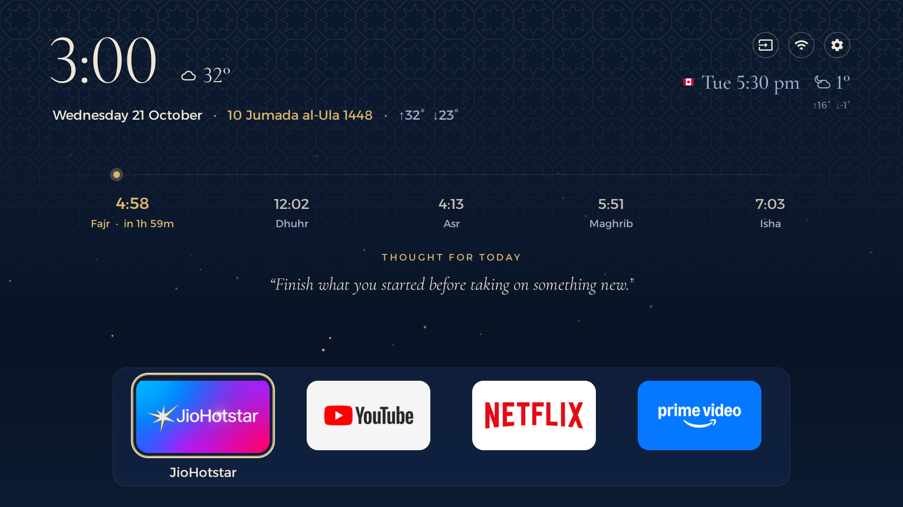
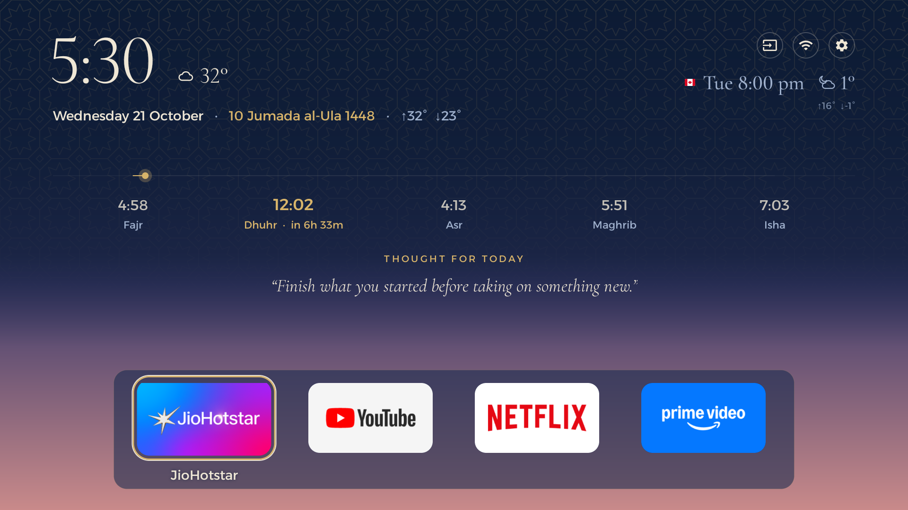
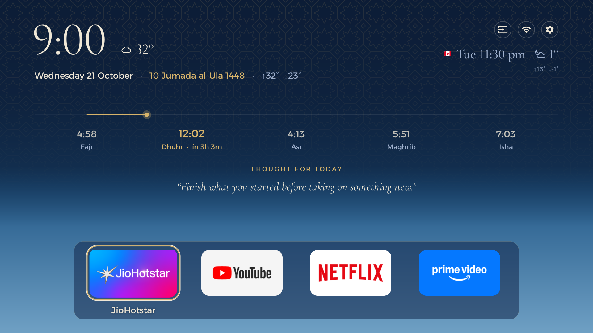
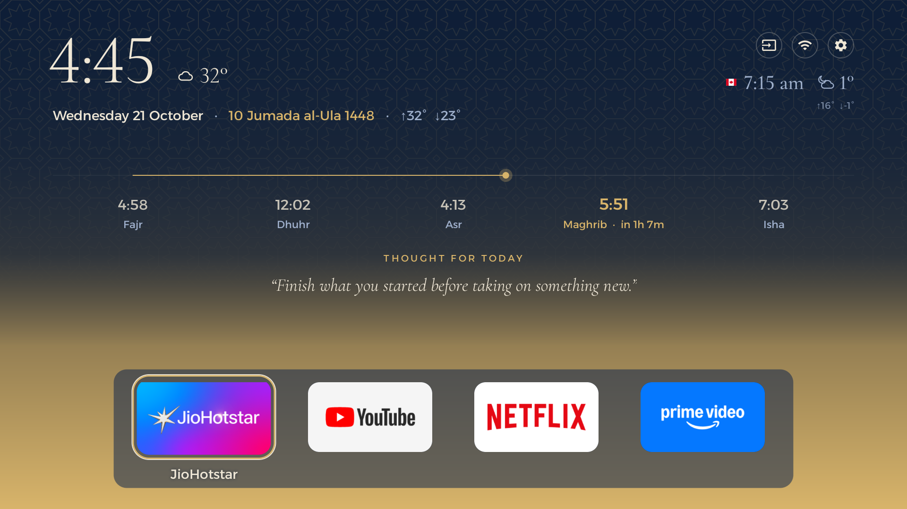
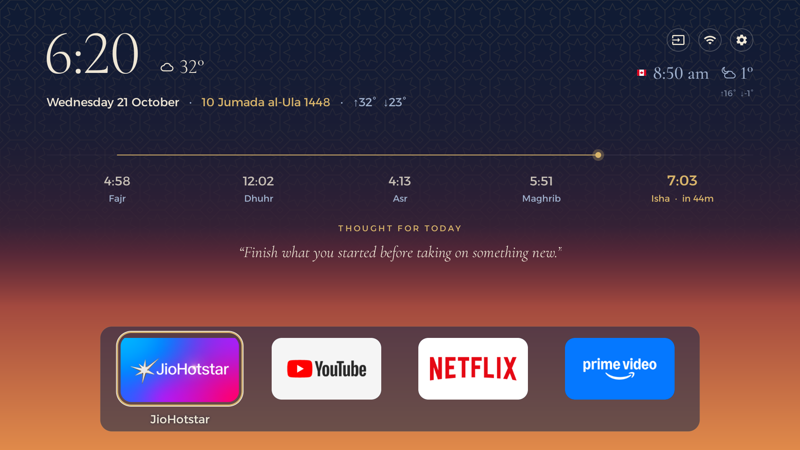
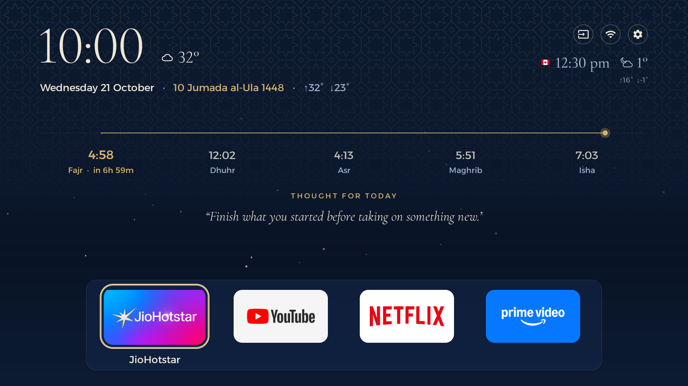
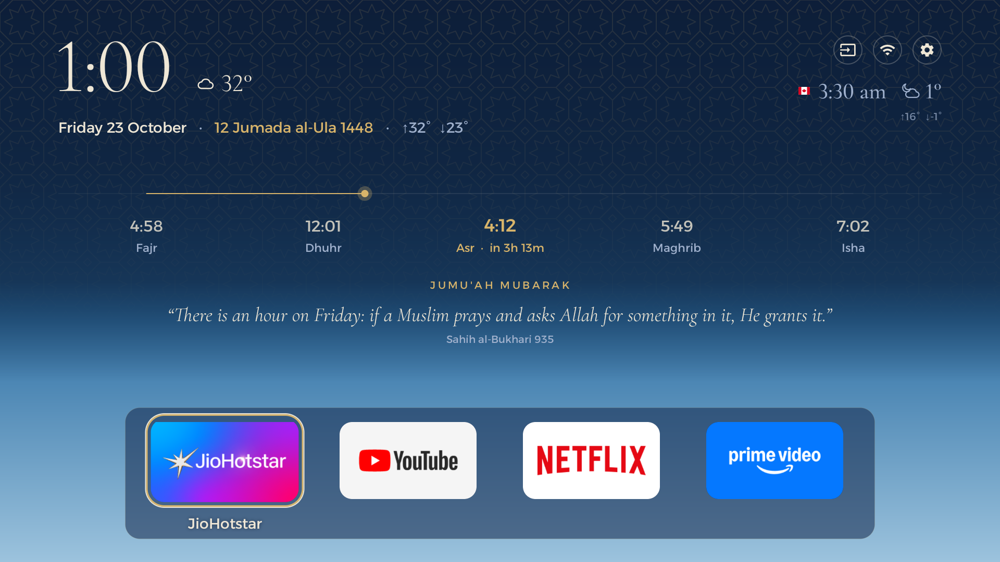
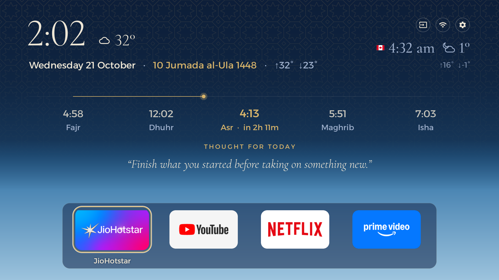
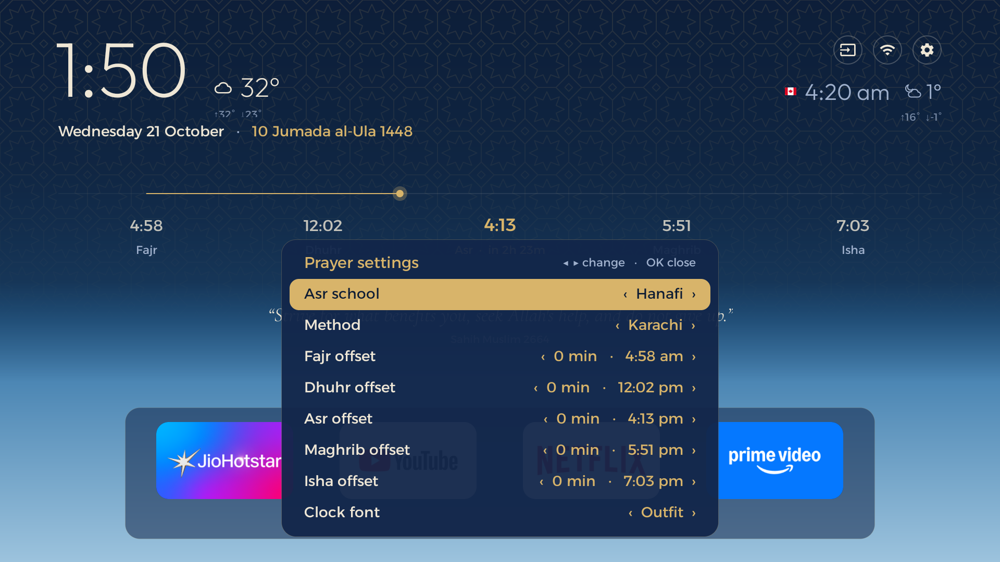

# WidgeTV

**A calm, widget-first home screen for Android TV: a sky that moves with the day, glanceable clocks,
weather and a daily thought, with prayer times built in.**


Most TV home screens are billboards. This one is a quiet window: the background shifts from dawn to
night through the day, the time and weather for you and someone far away sit in the corner, a single
thought sits in the middle, and your four apps wait at the bottom. Prayer times are built in, with a
timeline that shows where you are between one prayer and the next. You don't build it by hand: paste
[`PROMPT.md`](PROMPT.md) into Claude Code, answer a few questions, and it debloats the TV, configures the
launcher for your city and installs it. Everything is reversible.

## How it works

1. **On the TV**, turn on Developer options and USB/Network debugging (the prompt explains how).
2. **On your computer**, clone this repo, open [Claude Code](https://claude.com/product/claude-code) in it
   and paste [`PROMPT.md`](PROMPT.md).
3. **Answer its questions**: prayer times or not, your city and calculation method, an optional second
   clock city, weather units, which apps you use and which four go in the dock.
4. Claude Code **backs up** the TV, **debloats** it in small batches (disable only, never uninstall),
   **builds and installs** the launcher, makes it the home screen, **verifies** every step with
   screenshots pulled from the TV, and finally **closes ADB** again.

No root. No accounts. Nothing uninstalled. `tools/restore.sh` puts it all back.

## What you get

- **A sky that moves with the day.** The wallpaper drifts through dawn, morning, midday, golden hour,
  sunset and a starry night, timed to the real sun at your location, under a faint gold geometric
  pattern.
- **A big, quiet clock** in Cormorant Garamond or Outfit, with the date.
- **A second clock with a flag** for family abroad or the office, with the weekday when it's already
  tomorrow (or still yesterday) there.
- **Weather for both cities**: current temperature and icon beside each clock, with today's high and low.
  Open-Meteo, no key, fetched only while the home screen is on.
- **A thought of the day**: short hadith, Qur'an verses and plain productive reminders, every religious
  quote with a checked reference. Edit `content/thoughts.json` to make it yours.
- **An Apple TV style dock** with your four apps, a grid of everything else below, and a single gold
  focus ring that springs between them. Inputs, Wi-Fi and Settings sit in three round buttons.
- **Text size and clock font** you can change from the sofa.
- **A cleaner TV**: vendor promotions, telemetry and preloaded apps disabled, optional ad-blocking DNS.

### Prayer times, out of the box

- **A prayer timeline**: Fajr, Dhuhr, Asr, Maghrib and Isha on one line, with a dot that moves
  proportionally between the last prayer and the next.
- **Next-prayer countdown**: "Asr · in 3h 44m", in gold.
- **Hijri date** (Umm al-Qura) on the date line.
- **On-TV Prayer settings**: calculation method (10 methods), Asr school (Hanafi or Shafi'i), and
  per-prayer offsets of up to ±30 minutes to match your masjid. Calculated offline with adhan-java.
- **Friday**: a Jumu'ah Mubarak thought from a separate list of verified Qur'an verses and hadith.
- **Not your thing?** Set `prayer_enabled` to `false`: the timeline and Hijri date go away and the sky
  still follows sunrise and sunset.

## A day on the TV

The same screen at different times, simulated with the debug preview hooks (Hyderabad prayer times, a
second clock in Kitchener, Canada).

| | |
|---|---|
|  |  |
| **3:00** Night. Stars, and the dot creeping toward Fajr. The second clock shows yesterday. | **5:30** Dawn, just after Fajr. Dhuhr is next. |
|  |  |
| **9:00** Morning blue, halfway to Dhuhr. | **12:30** Midday. Asr is next. |
|  |  |
| **16:45** Golden hour after Asr. | **18:20** Sunset after Maghrib. |
|  |  |
| **22:00** Night. The line runs on toward tomorrow's Fajr. | **Friday 13:00** Jumu'ah Mubarak, with a verified hadith. |

**Text size**, Normal / Large / Larger, changed on the TV:

| | | |
|---|---|---|
|  |  |  |

**Prayer settings** on the TV: Asr school, method, per-prayer offsets with the adjusted time, clock font
(and text size, below the fold):



## Customise

Everything personal lives in one file,
[`launcher/app/src/main/res/values/config.xml`](launcher/app/src/main/res/values/config.xml). The prompt
fills it in for you; to change something later, edit it and run `tools/build-install.sh`.

| Key | What it does | Example |
|---|---|---|
| `prayer_enabled` | Prayer timeline, Hijri date, prayer-timed sky | `true` |
| `prayer_city_label`, `prayer_lat`, `prayer_lng` | Your city: prayer times, sky, weather | `Hyderabad`, `17.3850`, `78.4867` |
| `prayer_method` | Starting calculation method | `KARACHI` |
| `prayer_madhab` | Starting Asr school | `HANAFI` or `SHAFI` |
| `second_clock_enabled` | The second clock and its weather | `true` |
| `second_zone`, `second_flag` | Its IANA time zone and flag drawable | `America/Toronto`, `flag_ca` |
| `second_lat`, `second_lng` | Its coordinates, for weather | `43.4516`, `-80.4925` |
| `weather_enabled`, `weather_units` | Weather on/off, `celsius` or `fahrenheit` | `true`, `celsius` |
| `dock_packages` | The dock apps, left to right | Netflix, YouTube, ... |
| `hidden_packages` | Apps never shown in the grid | the dock apps, vendor leftovers |
| `pattern_mode` | `zellige` every day or `rotate` daily | `zellige` |
| `thoughts_enabled` | Thought of the day | `true` |
| `clock_font`, `text_size` | Starting values for the panel | `cormorant`, `normal` |

Flags shipped: Canada, India, UK, USA, UAE, Saudi Arabia, Pakistan. Claude Code draws a new one if you
need it. The thought list is in [`content/`](content/README.md). How the screen is built:
[`docs/DESIGN.md`](docs/DESIGN.md).

## Restoring

```bash
tools/restore.sh                        # re-enable everything, stock home back, DNS and screensaver restored
tools/restore.sh com.example.app        # re-enable one app
tools/restore.sh --uninstall-launcher   # everything, and remove the launcher too
```

Or on the TV, without a computer: Settings > Apps > See all apps > Show system apps, pick the app,
**Enable**. Everything that was disabled is listed in `state/disabled.txt`.

## After a firmware update

Small updates leave everything in place. A big one (say Android 14 to 15) can bring the stock home
screen and some vendor apps back. Nothing breaks; you just see the old home screen. Turn debugging on,
run `tools/reapply.sh` (about two minutes; it re-disables what came back and makes this launcher home
again), and close ADB. Details in [`docs/UPDATES.md`](docs/UPDATES.md). Keep automatic updates on.

## Privacy

- No accounts, no analytics, no ads, no tracking.
- One network call: weather from [Open-Meteo](https://open-meteo.com), with your two cities'
  coordinates, only while the home screen is in front, at most every 30 minutes. Turn it off with
  `weather_enabled`.
- Prayer times are calculated on the TV.
- The location permission is granted only so the Wi-Fi button can show your network's name.
- ADB is switched off and verified closed at the end of setup.

## Tested on

Tested on a Sony BRAVIA (VU31 platform), Android 14 Google TV, 2 GB RAM. Notes and the full disable
list: [`examples/sony-bravia-vu31.md`](examples/sony-bravia-vu31.md).

It should work on Android TV / Google TV 9 and newer (the launcher's `minSdk` is 28); older versions
are untested. Reports and `examples/<model>.md` pull requests are welcome.

The screenshots come from the original build on that TV; this generalised build compiles but has not
yet been run on hardware. If you try it, please open an issue with your TV model.

## Repo map

| Path | What |
|---|---|
| `PROMPT.md` | The prompt to paste into Claude Code |
| `launcher/` | The launcher (Java, single activity). Settings in `res/values/config.xml` |
| `tools/` | `backup`, `disable`, `restore`, `reapply`, `build-install`, `shot` scripts and `adb-closed.py` |
| `content/` | Thought of the day and its verification log |
| `docs/` | Updates, troubleshooting, design notes, screenshots |
| `examples/` | Per-TV notes |
| `state/` | Created on your machine: backups, disabled list, screenshots, your choices (gitignored) |

## Inspiration and credits

- [**cleanyourtv**](https://github.com/Gathin23/cleanyourtv) by Gathin: the idea of a prompt that has a
  coding assistant debloat a TV and build it a clean launcher. This project started from it.
- [**Afnon**](https://github.com/egyjs/afnon-android-tv-launcher) by egyjs: the prayer logic (adhan-java
  setup, offsets, Hijri date) and the lapis-and-gold design language with its star lattice.
- [**adhan-java**](https://github.com/batoulapps/adhan-java) by Batoul Apps: prayer-time astronomy.
- Fonts: [Cormorant Garamond](https://github.com/CatharsisFonts/Cormorant),
  [Outfit](https://github.com/Outfitio/Outfit-Fonts), [Alexandria](https://github.com/Gue3bara/Alexandria)
  (SIL OFL 1.1).
- Weather: [Open-Meteo](https://open-meteo.com) (CC BY 4.0).
- Quotes checked against [quran.com](https://quran.com) (Sahih International) and
  [sunnah.com](https://sunnah.com).

Full licence texts: [`NOTICE.md`](NOTICE.md).

## License

MIT, see [`LICENSE`](LICENSE). Third-party parts keep their own licences ([`NOTICE.md`](NOTICE.md)).
