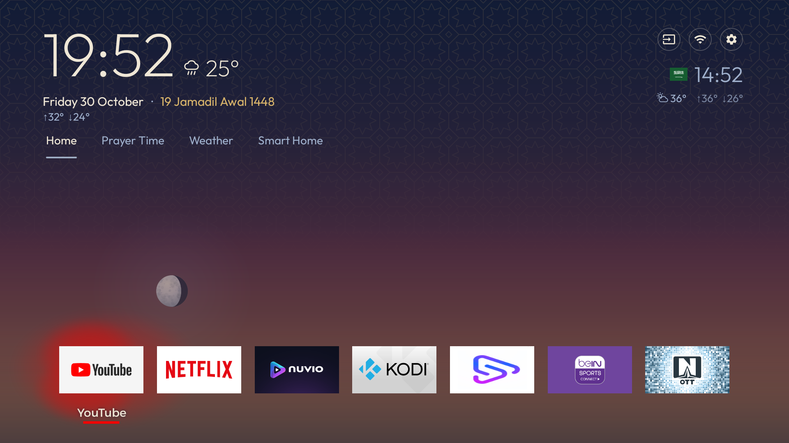
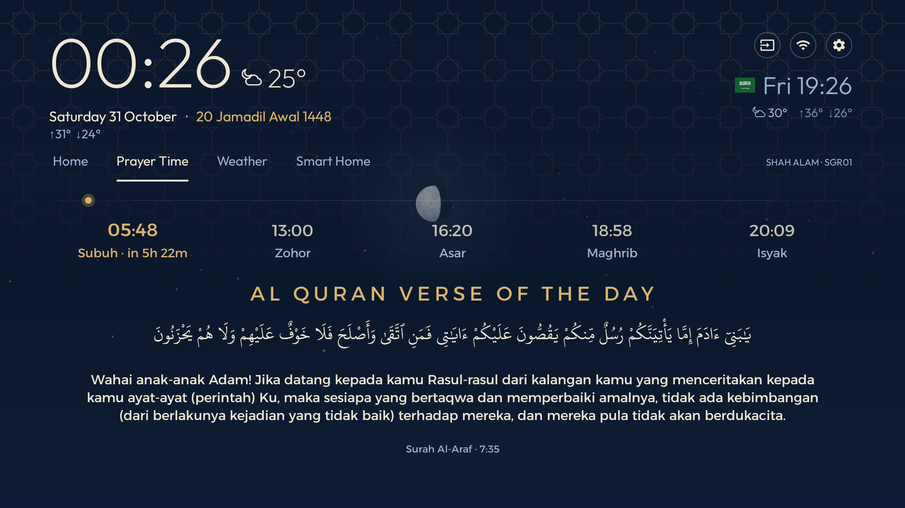
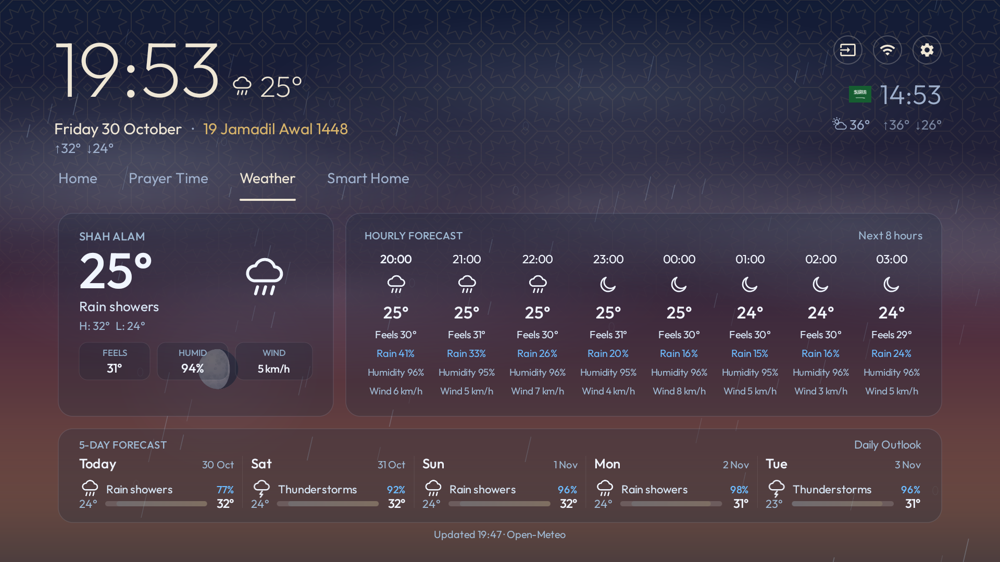
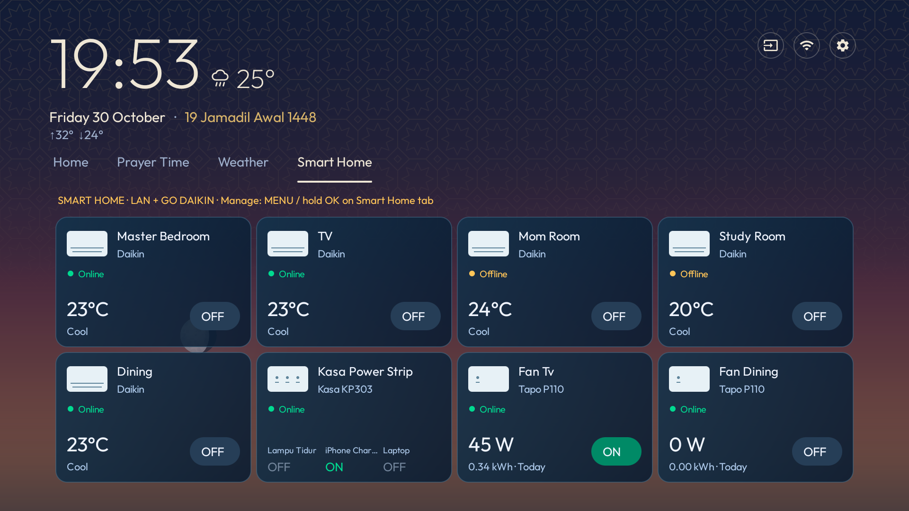

# Octahedron v3

A calm, widget-first Android TV launcher with a living sky, local and world clocks, official JAKIM prayer times, Arabic Quran verses with Malay translation, expanded weather forecasts and integrated smart-home controls. Built on WidgeTV and customized for Sony BRAVIA.

Use the TV remote to move between **Home**, **Prayer Time**, **Weather** and **Smart Home**. Screen-tab navigation wraps from the last tab to the first and back.

*Screenshots below were captured on Sony BRAVIA running Octahedron v3.0 (version code 13) on 30–31 October 2026. Prayer Time shows the current Quran-card preview; device states, forecasts and content reflect the capture time.*

## What's new in v3

- **Living sky:** a subtle clear-sky tint, translucent sun and moon, soft halos and horizon fades over the original geometric wallpaper. Daily moon illumination and waxing/waning orientation come from the official USNO calendar.
- **Quran verses by prayer time:** Arabic and original Malay translation from Mengaji.my, changing at each of the five official JAKIM prayer times. Text automatically fits the available space; no verse collection is bundled.
- **Expanded Weather screen:** current temperature, feels-like temperature, humidity and wind, up to eight upcoming hourly forecasts and a five-day outlook.
- **Dynamic ambient app lighting:** the focused app's colors illuminate the dock with smooth focus transitions.
- **Faster GO DAIKIN controls:** immediate optimistic display updates, debounced target dispatch and protection against background polling overwriting in-flight settings.
- **Controls for every online AC:** power, temperature, fan and operating-mode controls are available across registered online GO DAIKIN units, with consistent Online/Offline presence alongside Tapo and Kasa devices.
- **Remote navigation refinements:** wrapping screen tabs and a compact, top-aligned Prayer Time layout that keeps the full verse and translation visible without scrolling.

## The four screens

### Home



Local and secondary-city clocks, Gregorian and Malay Hijri dates, weather summaries, system shortcuts and an app dock sit over a geometric sky background. Choose four dock apps and open the remaining apps from the grid. Inputs, Wi-Fi and Settings remain accessible from the remote.

The living sky preserves the existing wallpaper and layout. The sun follows configured local sunrise and sunset timing. The moon moves along a decorative night arc; its position is an ambient illustration, not an astronomical altitude or moonrise prediction. Its illuminated fraction and phase orientation use the current local date's official calendar response.

The current day's moon data is cached privately. If it is unavailable, the moon is omitted until it loads; the sun and wallpaper continue working offline. Position updates run while the launcher is visible and stop when paused. See [living-sky behavior and checks](docs/living-sky.md).

### Prayer Time



A full-width, read-only **official JAKIM SGR01 prayer timeline** accompanies **HADITH OF THE DAY**. Prayer schedules are cached and refreshed; unavailable official data is not replaced with calculated times.

The **AL QURAN VERSE OF THE DAY** card displays original Arabic and Malay translation from [Mengaji.my](https://www.mengaji.my/api-docs/), whose translation is based on Tafsir Pimpinan Ar-Rahman by Sheikh Abdullah Basmeih. Arabic uses the official KFGQPC Hafs Uthmanic font, followed by a blank line and the Malay translation in Alexandria. The surah/ayah reference sits directly below the translation; the provider footer is hidden. Native auto-sizing preserves all wording without ellipsis or scrolling; very long verses use smaller text. The dock and app grid remain hidden.

The verse changes at Subuh, Zohor, Asar, Maghrib and Isyak using official JAKIM SGR01 times. It remains stable through Syuruk, midnight, reopening and app restarts within the same interval. An API request supplies each new verse; only the latest result is cached privately. A new interval requires Internet and a previous interval's verse is never silently substituted. This third-party Quran API is separate from JAKIM's prayer schedule. See [Quran verse details and checks](docs/prayer-quran-verse.md).

### Weather



The expanded screen uses [Open-Meteo](https://open-meteo.com/) for:

- Current conditions, feels-like temperature, humidity and wind speed.
- Up to eight upcoming hourly forecasts with temperature, condition icons, rain probability, humidity and wind.
- A five-day outlook with daily high/low temperatures and rain probability.
- An update timestamp and saved-forecast labeling when cached data is shown after a refresh failure.

Condition-driven weather atmosphere remains separate from the living-sky overlay. Rain effects depend on current conditions, not forecast precipitation probability. Weather summaries for the local and secondary cities remain in the header. No Open-Meteo API key is required.

### Smart Home



The integrated grid combines **GO DAIKIN air conditioners**, **Tapo P110 plugs** and a **Kasa KP303 three-outlet power strip**. Device controls open in floating dialogs, with remote focus returning to the grid when dismissed.

Open **Manage Devices** using MENU or by holding OK on the Smart Home tab. Scan or manually add a private LAN IP, enter account details privately, rename devices, assign rooms, reorder, refresh or remove entries.

**GO DAIKIN:** enter the account once through **Manage Devices → GO DAIKIN account**. The Java cloud client runs directly on the TV without an external backend. All registered online ACs expose power, temperature, fan and mode controls; offline controls are disabled. The UI updates immediately while cloud commands are dispatched, so a changed value on screen is not proof that the physical AC has applied it. Actual support depends on the unit and unofficial cloud API.

**Tapo and Kasa:** direct LAN transports support P110 KLAP v1/v2 and legacy AES login variants, plus KP303 legacy IOT outlets using device-reported identifiers. KP303 outlets share one card with individual outlet controls. Firmware compatibility and physical behavior require real-device verification.

Account details are stored using Android Keystore-backed encrypted storage. An explicit developer demo mode remains available; unsupported devices do not silently fall back to simulated controls. See [LAN protocols and limitations](docs/SMART-HOME-PROTOCOLS.md) and [earlier GO DAIKIN validation](docs/GO-DAIKIN-PHASE2.3.md). Those reports document earlier milestones and their restrictions; the current launcher enables controls for all online ACs.

## Build

Requires **JDK 17**, **Android SDK platform 34**, **build-tools 34.0.0** and the included **Gradle 8.7 wrapper**. Set `JAVA_HOME` and `ANDROID_HOME` to your installations.

From the repository root on Linux/macOS:

```bash
cd launcher
bash ./gradlew --no-daemon --max-workers=4 assembleDebug assembleRelease assembleDebugAndroidTest
```

On Windows, run `gradlew.bat assembleDebug assembleRelease assembleDebugAndroidTest` from `launcher/`.

| Output | Location under `launcher/` |
|---|---|
| Debug APK | `app/build/outputs/apk/debug/app-debug.apk` |
| Optimized release APK | `app/build/outputs/apk/release/app-release.apk` |
| Instrumentation-test APK | `app/build/outputs/apk/androidTest/debug/app-debug-androidTest.apk` |
| Release R8 mapping | `app/build/outputs/mapping/release/mapping.txt` |

Release builds enable R8 and resource shrinking. The current release variant uses the local debug signing identity; configure private release signing before external distribution. A newly generated key will not necessarily match an APK already installed on your TV. Keep the R8 mapping with each release.

**App identity:** the display name is **Octahedron**, with `versionName '3.0'` and `versionCode 13`. The package ID remains `tv.widgetv.home`; standard APK filenames are unchanged.

## Validation

Cloud development validation of the current source completed debug, optimized release and instrumentation-test APK builds. The four existing host suites passed **304 synthetic checks**: 70 TP-Link protocol/state, 75 GO DAIKIN cloud, 75 temperature-control and 84 fan/mode/control checks. These do not communicate with real devices or establish that the newer launcher UI and fast-control behavior work on hardware.

Host-test instructions are in [protocol-tests](launcher/protocol-tests/README.md) and the [GO DAIKIN proof of concept](launcher/godaikin-poc/README.md). They use Java 17 and the test-only `org.json:json:20240303` parser, which is not an APK dependency.

Android checks require an authorized test TV or compatible Android device. The default runner is `tv.widgetv.home.SmartHomeIntegrationChecks`. Feature-specific runners can be selected at build time:

```bash
# Run from launcher/. Build each test APK separately for its selected runner.
bash ./gradlew :app:assembleDebugAndroidTest -PtestRunner=tv.widgetv.home.PrayerVerseChecks
bash ./gradlew :app:assembleDebugAndroidTest -PtestRunner=tv.widgetv.home.LivingSkyChecks
```

After installing the debug app and the matching test APK on an authorized device, invoke the selected runner, for example:

```text
adb shell am instrument -w tv.widgetv.home.test/tv.widgetv.home.PrayerVerseChecks
```

Quran-verse checks include a real provider API request; living-sky checks include official USNO calendar requests. They are separate from cloud onboarding checks. Earlier hardware results are recorded in the linked reports; power and unexercised AC settings must not be treated as physically verified from build or mock-test results.

## Configure and install on a TV

Personal defaults live in [`launcher/app/src/main/res/values/config.xml`](launcher/app/src/main/res/values/config.xml): local and secondary-city coordinates, time zone, weather units, dock apps, hidden packages, clock font and text size. The current prayer screen uses official JAKIM SGR01 data; older upstream calculation-method instructions do not describe this screen.

For the guided TV setup, see [`PROMPT.md`](PROMPT.md), [Sony BRAVIA notes](examples/sony-bravia-vu31.md) and [troubleshooting](docs/TROUBLESHOOTING.md). Enable developer/network debugging and authorize ADB on your own TV before installing. With a configured JDK/SDK and reachable TV:

```bash
TV_IP=<your-tv-ip> bash tools/build-install.sh
```

The script builds a debug APK, installs it and attempts to make the launcher HOME. It also synchronizes `content/thoughts.json` into the app resources. Use the direct Gradle commands above when you only need to compile the existing checkout.

The TV management tools back up settings and disable selected packages rather than uninstalling them. Review the device-specific instructions before changing TV settings, and close ADB when finished.

## Restore and recover

```bash
bash tools/restore.sh                        # re-enable apps and restore stock settings
bash tools/restore.sh com.example.app        # re-enable one app
bash tools/restore.sh --uninstall-launcher   # restore and remove this launcher
```

Set `TV_IP` through the environment or the ignored `tools/tv.conf`. Backups, disabled-package lists and screenshots live in the ignored `state/` directory. You can also re-enable disabled apps from the TV's Settings → Apps menu.

After firmware updates, see [update recovery](docs/UPDATES.md) and `tools/reapply.sh`. Keep automatic firmware updates enabled.

## Network and privacy

There is no external backend requirement or analytics integration. Network use depends on enabled features:

| Feature | Connection |
|---|---|
| Weather | Open-Meteo, with configured city coordinates |
| Official prayer schedule | JAKIM schedule provider |
| Arabic Quran verse / Malay translation | `api.mengaji.my` |
| Daily moon phase | `aa.usno.navy.mil` |
| GO DAIKIN | Account authentication and device cloud API |
| Tapo/Kasa | Discovery and control on the local network |

Quran-verse, moon-calendar and prayer data are cached privately with feature-specific freshness rules. Normal TLS certificate and hostname verification remain enabled. The earlier MyHadith implementation remains historical source; see [its documentation](docs/daily-hadith.md).

Enter smart-home credentials privately on the TV. Do not commit credentials, TV backups or private signing keys. The original location permission supports showing the Wi-Fi network name; configured city coordinates supply weather and calendar requests.

## Repository guide

| Path | Purpose |
|---|---|
| `launcher/app/` | Main Android TV launcher and instrumentation checks |
| `launcher/godaikin-poc/` | Shared GO DAIKIN protocol sources and separate developer proof of concept |
| `launcher/protocol-tests/` | Host-only TP-Link protocol checks |
| `tools/` | Build/install, backup, restore, screenshots and TV management |
| `content/` | Bundled thought content and source verification; separate from live daily hadith |
| `docs/` | Design notes, feature behavior, historical validation and troubleshooting |
| `examples/` | Device-specific setup notes |
| `state/` | Ignored local TV backups and state |

The app targets Android SDK 34 with a minimum Android version of 9 (API 28). Earlier versions were tested on Sony BRAVIA Android 10 and Android 14 devices; this does not establish that every v3 feature has been tested on every model.

## Credits and license

Octahedron builds on **WidgeTV**, with inspiration from [cleanyourtv](https://github.com/Gathin23/cleanyourtv) and [Afnon](https://github.com/egyjs/afnon-android-tv-launcher). Included work also uses [adhan-java](https://github.com/batoulapps/adhan-java), Open-Meteo weather, official JAKIM/MyHadith content, USNO calendar data and the Cormorant Garamond, Outfit and Alexandria fonts.

See [`LICENSE`](LICENSE) for the MIT license and [`NOTICE.md`](NOTICE.md) for third-party notices. Third-party code, fonts and content retain their respective terms.
